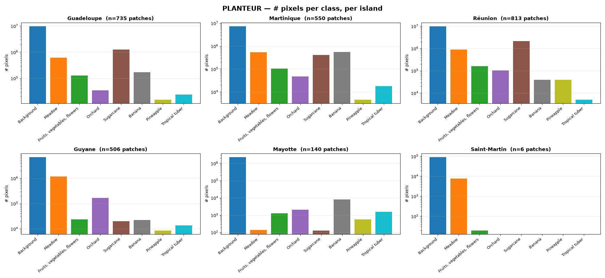

# PLANTEUR - Satellite Image Time Series Crop Type Segmentation Benchmark

PLANTEUR is a benchmark dataset for **panoptic and semantic segmentation of agricultural
parcels** in the **French overseas territories**. It is the tropical/overseas counterpart to
[PASTIS](https://github.com/VSainteuf/pastis-benchmark), and is distributed in the **exact
same file format** so that existing PASTIS / PASTIS-R dataloaders, collate functions, and
panoptic metrics work **unchanged** on the Sentinel-2, Sentinel-1 and label arrays (Landsat,
which PASTIS does not have, needs the loader in this repository).

Territories: **Guadeloupe, Martinique, Guyane, Réunion, Mayotte**, France's five overseas
departments and regions (*départements et régions d'outre-mer*, DROM), and a small number
of patches from **Saint-Martin**, an overseas collectivity (*collectivité d'outre-mer*, COM)
rather than a DROM.

## The PLANTEUR Dataset

- **Presentation**

Each patch is a multi-sensor satellite image time series of variable length, from
Sentinel-2 (optical), Sentinel-1 (radar) and Landsat-8 (optical and thermal), with per-pixel
panoptic annotations (instance index + semantic label) derived from the French Registre
Parcellaire Graphique (RPG 2019). Labels use **8 classes**, Background plus 7 crop classes
built around the crops that actually occur across the DROM (sugarcane, banana, pineapple,
tropical tuber, …); crops outside this taxonomy are marked void. We provide an official
spatial-block, territory-stratified train/val/test split and five leave-one-island-out
splits.

- **Dataset in numbers**

| | | |
|---|---|---|
| ▶️ 2,750 time series | ▶️ 47,256 parcels | ▶️ 8 classes + void |
| ▶️ **128×128 px / image** | ▶️ **40–150 S2 acquisitions / series** | ▶️ **10 m / pixel** (Landsat multispectral 20 m) |
| ▶️ **10 S2 + 2 S1 + 11 Landsat bands** | ▶️ **6 territories (5 DROM + Saint-Martin)** | ▶️ **Sept 2018 – Dec 2019** |

- 🛰️ **Multimodal (optical + radar + thermal).** Every patch has aligned Sentinel-2,
  Sentinel-1 (VV/VH) and Landsat-8 time series over the same footprint, each with its own
  acquisition dates, for multi-sensor fusion experiments.

## Usage

- **Download**

The dataset (~133 GB) is hosted on the Hugging Face Hub:

> **https://huggingface.co/datasets/allenai/planteur-benchmark**

A 25-patch preview (`sample/sample.parquet`) renders in the Hugging Face dataset viewer, so
the imagery, labels and per-patch metadata can be browsed without downloading the arrays.

- **Data loading**

This repository contains a PyTorch dataset class in `code/dataloader.py` that loads PLANTEUR
for semantic and panoptic segmentation (identical API to PASTIS). `sats` takes any of `"S2"`,
`"S1"`, `"LS"` (Landsat multispectral, 64×64) and `"LS_PAN"` (Landsat panchromatic, 128×128).
`code/collate.py` provides `pad_collate` for temporally padding variable-length series. For
parcel classification, `code/dataloader_pixelset.py` yields PASTIS-R-style pixel sets (one
sample per parcel; void and Background excluded), extracted on the fly from the patch arrays.

```python
import sys; sys.path.append("code")
from dataloader import PLANTEUR_Dataset
train = PLANTEUR_Dataset(folder="<PLANTEUR_ROOT>", sats=["S2"], folds=[1])
test  = PLANTEUR_Dataset(folder="<PLANTEUR_ROOT>", sats=["S2", "S1"], target="instance", folds=[5])
ls    = PLANTEUR_Dataset(folder="<PLANTEUR_ROOT>", sats=["LS", "LS_PAN"], folds=[1])

from dataloader_pixelset import PLANTEUR_Dataset_PixelSet
parcels = PLANTEUR_Dataset_PixelSet(folder="<PLANTEUR_ROOT>", sats=["S2"], folds=[1])
```

- **Georeferencing**

`ANNOTATIONS_GEOTIFF/TARGET_<id>.tif` holds the semantic labels as GeoTIFFs carrying each
patch's CRS and affine transform (uint8, 128×128, `nodata=255`), with pixel values identical
to `ANNOTATIONS/TARGET_<id>.npy`. The imagery arrays share the same grid, so a patch's label
GeoTIFF also georeferences its `DATA_*` arrays. Patches span five UTM zones (EPSG:32620,
32621, 32622, 32738, 32740), so there is no single CRS for the dataset; per-patch footprints
are also in `metadata.geojson.geometry` (EPSG:4326).

```python
import rasterio
with rasterio.open("ANNOTATIONS_GEOTIFF/TARGET_0.tif") as src:
    labels = src.read(1)          # (128,128) uint8, 255 = void
    crs, transform = src.crs, src.transform
```

- **Metrics**

`code/panoptic_metrics.py` provides the PyTorch panoptic metrics (SQ/RQ/PQ). Void (255)
must be excluded from both loss and metrics: for semantic segmentation report mean IoU
over the 8 classes with void ignored, and for panoptic use
`PanopticMeter(num_classes=8, void_label=255, background_label=0)`, which scores PQ over
the 7 crop classes (background and void both excluded).

Trainers that allocate one output channel per class cannot represent 255 directly; see the
[documentation](documentation/planteur-documentation.md#2-classes-8--void) for how to remap it.

- **Visualization**

See `demo.ipynb` for loading and visualizing samples. Per-island class distributions are in
`images/`.

## Splits

### Default (spatial-block, territory-stratified)

| Fold | role | patches |
|--:|---|--:|
| 1 | train | 1,896 |
| 4 | val | 411 |
| 5 | test | 443 |

Whole 0.1° (~11 km) spatial blocks are assigned to a single split, and each territory (hence
every crop class) is represented across train/val/test. The 70/15/15 target is applied per
territory; because blocks are indivisible the realised ratios vary, most for Mayotte. The same
assignment is in `splits/443.json` as explicit ID lists. Per-territory ratios and the 592
parcels that reach more than one split are documented in
[`documentation/planteur-documentation.md`](documentation/planteur-documentation.md#3-splits).

### Leave-one-island-out (LOIO)

`splits/loio.json` holds five additional configurations. For each held-out territory,
`test` is all of its patches; `train`/`val` come from the same spatial-block,
territory-stratified 70/15/15 assignment over the remaining territories.

| held-out (test) | train | val | test |
|---|--:|--:|--:|
| Guadeloupe | 1,750 | 265 | 735 |
| Martinique | 1,950 | 250 | 550 |
| Guyane | 1,960 | 284 | 506 |
| Réunion | 1,720 | 217 | 813 |
| Mayotte | 2,296 | 314 | 140 |

Per-patch territory is in `metadata.geojson.Island`. Saint-Martin (6 patches) is
labelled but never held out — it stays in `train` for every fold.

## Data generation

`data_generation/` holds the scripts used to build PLANTEUR, for provenance. They read an
[rslearn](https://github.com/allenai/rslearn) dataset in which the imagery was materialized
and the RPG labels were rasterized, so they are not runnable without that dataset.
`build_pastis_rpg_map.py` reproduces `pastis_rpg_class_map.json` from the RPG crop-code
list in `data_generation/data/rpg_culture_codes.csv`, and `plot_class_distributions.py`
regenerates the charts in `images/` from the released dataset.

## Documentation

The 8-class nomenclature and full format specification (arrays, shapes, metadata, provenance)
are in [`documentation/planteur-documentation.md`](documentation/planteur-documentation.md).
Class names: `documentation/label_names.json`; the full 26-class → class-id mapping:
`documentation/class_map.json`; visualization colors: `documentation/colormap.txt`.



## References

If you use PLANTEUR, please cite:
```
@misc{planteur2026,
  title  = {PLANTEUR: Satellite Image Time Series Crop Type Segmentation Benchmark},
  author = {Wolters, Piper and Tseng, Gabriel and Zhang, Yawen and Redmon, Joseph and
            Bastani, Favyen and Sablon, Hadrien and Shah, Ando},
  year   = {2026}
}
```
This dataset follows the format of PASTIS; if you use it, please also cite PASTIS:
```
@inproceedings{garnot2021panoptic,
  title     = {Panoptic Segmentation of Satellite Image Time Series with Convolutional Temporal Attention Networks},
  author    = {Sainte Fare Garnot, Vivien and Landrieu, Loic},
  booktitle = {Proceedings of the IEEE/CVF International Conference on Computer Vision (ICCV)},
  year      = {2021}
}
```

## License

This benchmark dataset is licensed under ODC-BY. It is intended for research and educational use in
accordance with Ai2's [Responsible Use Guidelines](https://allenai.org/responsible-use).

The code in this repository is released under the MIT License (see `LICENSE`).

## Credits

The data is processed from satellite imagery and labels provided by the following sources:

- Sentinel-1 Synthetic Aperture Radar (SAR) - Radiometrically Terrain Corrected (RTC) dataset provided by the European Space Agency and accessed from Microsoft Planetary Computer at https://planetarycomputer.microsoft.com/dataset/sentinel-1-rtc
- Sentinel-2 Level 2-A dataset provided by the European Space Agency and accessed from Microsoft Planetary Computer at https://planetarycomputer.microsoft.com/dataset/sentinel-2-l2a
- USGS Landsat - Earth Resources Observation and Science (EROS) Center. (2020). Landsat 8-9 Operational Land Imager / Thermal Infrared Sensor Level-1, Collection 2 dataset. U.S. Geological Survey. https://doi.org/10.5066/P975CC9B. Accessed from https://registry.opendata.aws/usgs-landsat
- Le Registre Parcellaire Graphique (RPG) dataset at https://cartes.gouv.fr/rechercher-une-donnee/dataset/IGNF_RPG?redirected_from=geoservices.ign.fr

The file format is adapted from [PASTIS](https://github.com/VSainteuf/pastis-benchmark) (V. Sainte Fare Garnot & L. Landrieu), MIT-licensed.
