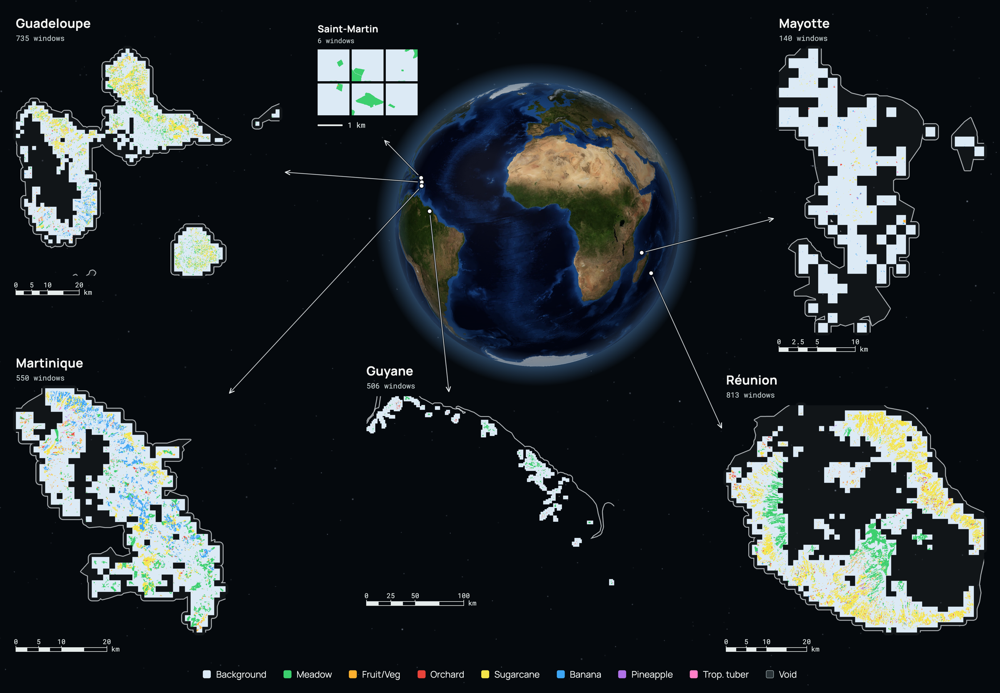

# PLANTEUR - Satellite Image Time Series Crop Type Segmentation Benchmark

PLANTEUR is a benchmark dataset for **panoptic and semantic segmentation of agricultural
parcels** in the **French overseas territories**. It is the tropical/overseas counterpart to
[PASTIS](https://github.com/VSainteuf/pastis-benchmark), and is distributed in almost the
**exact same file format** so that existing PASTIS dataloaders work mostly unchanged with the
Sentinel-2, Sentinel-1, and label arrays (Landsat-8, which PASTIS does not have, needs the
loader in this repository).

Territories: **Guadeloupe, Martinique, Guyane, Réunion, Mayotte**, France's five overseas
departments and regions (*départements et régions d'outre-mer*, DROM), and a small number
of patches from **Saint-Martin**, an overseas collectivity (*collectivité d'outre-mer*, COM)
rather than a DROM.



## The PLANTEUR Dataset

- **Presentation**

Each patch is a multi-sensor satellite image time series of variable length, from
Sentinel-2 (optical), Sentinel-1 (radar) and Landsat-8 (optical and thermal), with per-pixel
panoptic annotations (instance index + semantic label) derived from the French Registre
Parcellaire Graphique (RPG 2019). Labels use **8 classes**, Background plus 7 crop classes
built around the crops that actually occur across the DROM (sugarcane, banana, pineapple,
tropical tuber, …); crops outside this taxonomy are marked void. We provide an official
spatial-block, territory-stratified train/val/test split and five leave-one-island-out
splits.

- **Dataset in numbers**

| | | |
|---|---|---|
| ▶️ 2,750 time series | ▶️ 47,256 parcels | ▶️ 8 classes + void |
| ▶️ **128×128 px / image** | ▶️ **40–150 S2 acquisitions / series** | ▶️ **10 m / pixel** (Landsat multispectral 20 m) |
| ▶️ **10 S2 + 2 S1 + 11 Landsat bands** | ▶️ **6 territories (5 DROM + Saint-Martin)** | ▶️ **Sept 2018 – Dec 2019** |

- 🛰️ **Multimodal (optical + radar + thermal).** Every patch has aligned Sentinel-2,
  Sentinel-1 (VV/VH) and Landsat-8 time series over the same footprint, each with its own
  acquisition dates, for multi-sensor fusion experiments.

## Usage

- **Download**

The dataset (~258 GB: ~133 GB per-observation arrays and labels, ~21 GB monthly mosaics and ~104 GB embeddings) is hosted on the Hugging Face Hub:

> **https://huggingface.co/datasets/allenai/planteur-benchmark**

Install the dependencies with `pip install -r code/requirements.txt`.

- **Data loading**

This repository contains a PyTorch dataset class in `code/dataloader.py` that loads PLANTEUR
for semantic and panoptic segmentation (identical API to PASTIS). `sats` takes any of `"S2"`,
`"S1"`, `"LS"` (Landsat multispectral, 64×64), `"LS_PAN"` (Landsat panchromatic, 128×128) and
`"S2_MONTHLY"` (the 12 monthly 2019 Sentinel-2 mosaics used in the paper).
`annotations="ANNOTATIONS_BALANCED"` loads the class-balanced training labels.
`code/collate.py` provides `pad_collate` for temporally padding variable-length series. For
parcel classification, `code/dataloader_pixelset.py` yields PASTIS-R-style pixel sets (one
sample per parcel; void and Background excluded), extracted on the fly from the patch arrays.

```python
import sys; sys.path.append("code")
from dataloader import PLANTEUR_Dataset
train = PLANTEUR_Dataset(folder="<PLANTEUR_ROOT>", sats=["S2"], folds=[1])
test  = PLANTEUR_Dataset(folder="<PLANTEUR_ROOT>", sats=["S2", "S1"], target="instance", folds=[5])
ls    = PLANTEUR_Dataset(folder="<PLANTEUR_ROOT>", sats=["LS", "LS_PAN"], folds=[1])

from dataloader_pixelset import PLANTEUR_Dataset_PixelSet
parcels = PLANTEUR_Dataset_PixelSet(folder="<PLANTEUR_ROOT>", sats=["S2"], folds=[1])
```

PASTIS-R splits Sentinel-1 into ascending and descending series (`DATA_S1A`, `DATA_S1D`).
PLANTEUR has one `DATA_S1` series per patch that contains both orbit directions in date order
(2,746 of 2,750 patches have both; same-day ascending and descending passes, about 3% of
dates, are averaged into one observation). PASTIS-R code therefore does not load PLANTEUR out
of the box; use `"S1"` in place of `"S1A"`/`"S1D"`. With the upstream PASTIS loader:

```python
import sys; sys.path.append("<PASTIS_BENCHMARK>/code")   # github.com/VSainteuf/pastis-benchmark
from dataloader import PASTIS_Dataset
ds = PASTIS_Dataset(folder="<PLANTEUR_ROOT>", sats=["S2", "S1"], target="semantic", folds=[1])
```

The orbit direction of each `DATA_S1` observation is in `metadata.geojson` as `orbits-S1`
(`{step: "A" | "D" | "AD"}`, aligned with `dates-S1`; `"AD"` marks a same-day average of both),
so an ascending or descending series can be cut out of `DATA_S1`:

```python
import json, numpy as np
meta = {f["properties"]["ID_PATCH"]: f["properties"]
        for f in json.load(open("<PLANTEUR_ROOT>/metadata.geojson"))["features"]}
p = meta[0]
s1 = np.load("<PLANTEUR_ROOT>/DATA_S1/S1_0.npy")                      # (T_s1, 2, 128, 128)
steps = sorted(p["orbits-S1"], key=int)
asc = [int(k) for k in steps if p["orbits-S1"][k] == "A"]
s1_asc, dates_asc = s1[asc], [p["dates-S1"][str(k)] for k in asc]
```

The PASTIS-R pixel-set loader also needs parcel-level files (`metadata_parcel.csv`) that
PLANTEUR does not ship; use `PLANTEUR_Dataset_PixelSet` above, which builds the pixel sets
from the patch arrays.

- **Monthly mosaics**

HF includes the fixed-length monthly inputs (~21 GB) used in some of the paper's linear-probe and
fine-tuning experiments: 12 months per patch, month `m` covering the 30 days from
2019-01-01 + 30·m days, each the lowest-cloud-cover scene mosaic of that period. They are
not derivable from the `DATA_*` arrays. `PLANTEUR_Dataset(sats=["S2_MONTHLY"])` loads the 10
`DATA_S2` bands of the Sentinel-2 mosaics, as U-TAE and TSViT used them; load the other files
directly. A month with no scene is all zeros (only Landsat has gaps); `MONTHLY/months.json`
lists which months are present per patch and sensor.

| file | shape | dtype |
|---|---|---|
| `DATA_S2_MONTHLY/S2_<id>.npy` | (12, 12, 128, 128) | uint16 — the 10 `DATA_S2` bands, then B01, B09 |
| `DATA_S1_MONTHLY/S1_<id>.npy` | (12, 2, 128, 128) | float32 — VV, VH |
| `DATA_LS_MONTHLY/LS_<id>.npy` | (12, 10, 64, 64) | uint16 — same bands as `DATA_LS` |
| `DATA_LS_PAN_MONTHLY/LSPAN_<id>.npy` | (12, 1, 128, 128) | uint16 — B8 |

```python
import json, numpy as np
s2 = np.load("<PLANTEUR_ROOT>/DATA_S2_MONTHLY/S2_0.npy")             # (12, 12, 128, 128)
present = json.load(open("<PLANTEUR_ROOT>/MONTHLY/months.json"))["present"]["0"]["LS"]  # 12 bools
```

`NORM_S2_MONTHLY_patch.json` has per-fold mean/std for the 10 `DATA_S2` bands of the
monthly Sentinel-2 mosaics, in the same format as `NORM_S2_patch.json`.

- **Precomputed embeddings**

HF also has 2019 embedding products (~104 GB) linear-probed in the paper, exported
per patch on the same 128×128, 10 m grid as the labels, so embedding pixel `[:, r, c]`
aligns with label pixel `[r, c]`.

| file | shape (C, H, W) | product | no data |
|---|---|---|---|
| `EMB_AEF/AEF_<id>.npy` | (64, 128, 128) float32 | [AlphaEarth Foundations Satellite Embedding V1](https://developers.google.com/earth-engine/datasets/catalog/GOOGLE_SATELLITE_EMBEDDING_V1_ANNUAL), 2019 annual | `-1` (none in this release) |
| `EMB_TESSERA_V1/TESSERA_<id>.npy` | (128, 128, 128) float32 | Tessera v1 | all-zero vector, or `NaN` |
| `EMB_TESSERA_V1_1/TESSERA_<id>.npy` | (128, 128, 128) float32 | Tessera v1.1 | `NaN` |
| `EMB_TESSERA_V2/TESSERA_<id>.npy` | (128, 128, 128) float32 | Tessera v2, generated with the released [v2 inference code](https://github.com/ucam-eo/tessera) | |
| `EMB_OLMOEARTH_V1_3/OE13_<id>.npy` | (128, 128, 128) float32 | OlmoEarth v1.3, 128-d projection (the 64-d read-out is the first 64 channels), int8 round-tripped as probed | |

`EMB_MISSING.json` lists missing patches per folder, for Tessera v1 where applicable.

```python
import numpy as np
emb = np.load("<PLANTEUR_ROOT>/EMB_AEF/AEF_0.npy")                    # (64, 128, 128)
lab = np.load("<PLANTEUR_ROOT>/ANNOTATIONS/TARGET_0.npy")             # (1, 128, 128)
X, y = emb.reshape(64, -1).T, lab.ravel()                             # per-pixel features, labels
keep = (y != 255) & (X != -1).any(1)                                  # drop void and no-data pixels
X, y = X[keep], y[keep]
```

The AlphaEarth Foundations embeddings are CC-BY 4.0 (*"The AlphaEarth Foundations Satellite
Embedding dataset is produced by Google and Google DeepMind."*); Tessera embeddings are CC0.

- **Georeferencing**

`ANNOTATIONS_GEOTIFF/TARGET_<id>.tif` holds the semantic labels as GeoTIFFs carrying each
patch's CRS and affine transform (uint8, 128×128, `nodata=255`), with pixel values identical
to `ANNOTATIONS/TARGET_<id>.npy`. The imagery arrays share the same grid, so a patch's label
GeoTIFF also georeferences its `DATA_*` arrays. Patches span five UTM zones (EPSG:32620,
32621, 32622, 32738, 32740), so there is no single CRS for the dataset; per-patch footprints
are also in `metadata.geojson.geometry` (EPSG:4326).

```python
import rasterio
with rasterio.open("<PLANTEUR_ROOT>/ANNOTATIONS_GEOTIFF/TARGET_0.tif") as src:
    labels = src.read(1)          # (128,128) uint8, 255 = void
    crs, transform = src.crs, src.transform
```

- **Metrics**

Void (255) must be excluded from both loss and metrics. For semantic segmentation report
mean IoU over all 8 classes with void ignored; a class absent from the labels of the evaluated
patches (e.g. a crop that does not occur on a held-out island) counts as IoU 0 in the mean.

Trainers that allocate one output channel per class cannot represent 255 directly; see the
[documentation](documentation/planteur-documentation.md#2-classes-8--void) for how to remap it.

- **Visualization**

See `demo.ipynb` for loading and visualizing samples. Per-island class distributions are in
`images/`.

## Splits

### Default (spatial-block, territory-stratified)

| Fold | role | patches |
|--:|---|--:|
| 1 | train | 1,896 |
| 4 | val | 411 |
| 5 | test | 443 |

Whole 0.1° (~11 km) spatial blocks are assigned to a single split, and each territory (hence
every crop class) is represented across train/val/test. The 70/15/15 target is applied per
territory; because blocks are indivisible the realised ratios vary, most for Mayotte. The same
assignment is in `splits/443.json` as explicit ID lists (named for its 443 test patches). Per-territory ratios and the 592
parcels that reach more than one split are documented in
[`documentation/planteur-documentation.md`](documentation/planteur-documentation.md#3-splits).

### Leave-one-island-out (LOIO)

`splits/loio.json` holds five additional configurations. For each held-out territory,
`test` is all of its patches; `train`/`val` split the remaining territories' patches
(about 88/12), as used in the paper. Unlike the default split, this train/val split is not
block-aligned: train and val share 0.1° blocks, so val scores are optimistic. `test` never
shares a block with `train` or `val`.

| held-out (test) | train | val | test |
|---|--:|--:|--:|
| Guadeloupe | 1,750 | 265 | 735 |
| Martinique | 1,950 | 250 | 550 |
| Guyane | 1,960 | 284 | 506 |
| Réunion | 1,720 | 217 | 813 |
| Mayotte | 2,296 | 314 | 140 |

Per-patch territory is in `metadata.geojson.Island`. Saint-Martin (6 patches) is
labelled but never held out — it stays in `train` for every fold.

The loaders select patches by `folds`; to use the LOIO lists, wrap a dataset in a `Subset`:

```python
import json
from torch.utils.data import Subset
ds = PLANTEUR_Dataset(folder="<PLANTEUR_ROOT>", sats=["S2"])
loio = json.load(open("<PLANTEUR_ROOT>/splits/loio.json"))["folds"]["Guadeloupe"]
train = Subset(ds, [ds.id_patches.get_loc(i) for i in loio["train"]])
```

The `NORM_*` statistics are computed on the default train fold, which includes patches of
every island, so they are not held-out statistics for a LOIO run.

## Documentation

The 8-class nomenclature and full format specification (arrays, shapes, metadata, provenance)
are in [`documentation/planteur-documentation.md`](documentation/planteur-documentation.md).
Class names: `documentation/label_names.json`; the full 26-class → class-id mapping:
`documentation/class_map.json`; visualization colors: `documentation/colormap.txt`.


## References

If you use PLANTEUR, please cite:
```
@misc{planteur2026,
  title        = {PLANTEUR: A Crop-Type Segmentation Benchmark for Tropical Regions},
  author       = {Wolters, Piper and Tseng, Gabriel and Zhang, Yawen and Redmon, Joseph and
                  Bastani, Favyen and Sablon, Hadrien and Shah, Ando},
  year         = {2026},
  howpublished = {\url{https://huggingface.co/datasets/allenai/planteur-benchmark}}
}
```
This dataset follows the format of PASTIS; if you use it, please also cite:
```
@inproceedings{garnot2021panoptic,
  title     = {Panoptic Segmentation of Satellite Image Time Series with Convolutional Temporal Attention Networks},
  author    = {Sainte Fare Garnot, Vivien and Landrieu, Loic},
  booktitle = {Proceedings of the IEEE/CVF International Conference on Computer Vision (ICCV)},
  year      = {2021}
}
```

## License

This benchmark dataset is licensed under ODC-BY. It is intended for research and educational use in
accordance with Ai2's [Responsible Use Guidelines](https://allenai.org/responsible-use).

The code in this repository is released under the MIT License (see `LICENSE`).

## Credits

The data is processed from satellite imagery and labels provided by the following sources:

- Sentinel-1 Synthetic Aperture Radar (SAR) - Radiometrically Terrain Corrected (RTC) dataset provided by the European Space Agency and accessed from Microsoft Planetary Computer at https://planetarycomputer.microsoft.com/dataset/sentinel-1-rtc
- Sentinel-2 Level 2-A dataset provided by the European Space Agency and accessed from Microsoft Planetary Computer at https://planetarycomputer.microsoft.com/dataset/sentinel-2-l2a
- USGS Landsat - Earth Resources Observation and Science (EROS) Center. (2020). Landsat 8-9 Operational Land Imager / Thermal Infrared Sensor Level-1, Collection 2 dataset. U.S. Geological Survey. https://doi.org/10.5066/P975CC9B. Accessed from https://registry.opendata.aws/usgs-landsat (PLANTEUR uses Landsat 8 scenes only)
- Le Registre Parcellaire Graphique (RPG) dataset at https://cartes.gouv.fr/rechercher-une-donnee/dataset/IGNF_RPG?redirected_from=geoservices.ign.fr

The file format is adapted from [PASTIS](https://github.com/VSainteuf/pastis-benchmark) (V. Sainte Fare Garnot & L. Landrieu), MIT-licensed.
